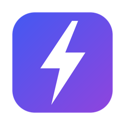

<p align="center"></p>

<h1 align="center">Lightron</h1>

<p align="center">Desktop apps in Go and web pages, on the Chromium the computer already has.<br>
A 3 MB download instead of Electron's 100 MB.</p>

<p align="center">
<a href="https://pkg.go.dev/github.com/zbysir/lightron"></a>
<a href="https://github.com/zbysir/lightron/actions/workflows/ci.yml"></a>
<a href="LICENSE"></a>
</p>

```go
lightron.Run(lightron.Options{
	Name:    "Notes",
	ID:      "com.example.notes",
	Icon:    icon,
	Handler: http.FileServer(http.FS(pages)), // or URL: "http://localhost:8080"
	Bind: map[string]any{
		"save": func(name, text string) error { return os.WriteFile(name, []byte(text), 0o644) },
	},
})
```

```js
await lightron.invoke("save", "todo.md", text);
```

## Why

An Electron app ships a whole Chromium: every app 100–200 MB to download, and as much again on disk. Yet nearly every
Mac has Chrome (or Edge, Brave), and every Windows 10/11 machine has WebView2. Lightron runs your app on that one.

What you ship is a Go program. Measured on the `hello` example:

| | Download | On disk |
|---|---|---|
| macOS (arm64) `.dmg` | 3.0 MB | 6.5 MB |
| Windows (x64) installer | 2.3 MB | 7.0 MB |

And unlike opening a browser window from Go (lorca and the like), the app is an app: on macOS, its own name and icon
in the Dock and ⌘Tab, its own menu bar, its own notifications; windows with a bare title bar, not a browser's tabs
and address bar.

## How

- **macOS: the user's own Chrome**, or Edge, Brave, Chromium. Lightron makes a copy of the browser's bundle in the
  app's data directory (an APFS clone: a second, and no disk space), renamed into your app (name, bundle id, icon), and
  runs that, so macOS sees your app, not Chrome. It drives the browser over the DevTools protocol, on a pipe. Windows
  are `--app` windows. A small library loaded into the browser edits its menu bar into yours and handles the Dock.
- **Windows: WebView2**, the system's Chromium (Edge's engine, updated with Windows), in a window of the app's own.

Both are current Chromium: the same web platform as Chrome, the DevTools you know, no polyfills.

[docs/architecture.md](docs/architecture.md) explains each part and why it is done that way.

## Getting started

Go 1.23 or later.

```sh
go install github.com/zbysir/lightron/cmd/lightron@latest
lightron init notes        # main.go, web/index.html, icon.png, lightron.json
cd notes && go run .
```

Package it:

```sh
lightron build             # dist/Notes-0.1.0-darwin-arm64.dmg, …-windows-amd64-setup.exe, .zip of each
```

`lightron build` cross-compiles: from a Mac you get the macOS and Windows packages (the Windows installer needs
`makensis`: `brew install makensis`). `lightron doctor` says what this machine has.

## The page's side

Every page of the app gets `window.lightron`:

```js
await lightron.invoke("name", ...args) // call a function in Options.Bind; rejects with its error
lightron.send(value)                   // to Options.OnMessage
lightron.on("event", (data) => {})     // from app.Emit / window.Emit; returns an unsubscribe function
lightron.focus()                       // bring this window (and the app) forward, e.g. from a notification's onclick
lightron.getPathForFile(file)          // a dropped / pasted / picked File's path on disk ("" if it has none);
                                       // also in an app's page in another site's iframe
lightron.platform                      // "darwin" | "windows"
```

Links to other sites (`<a href>` and `window.open`) open in the default browser. A window can also navigate to another
site (an app that shows a web app, say): `window.lightron` and `Bind` are only ever on the app's own origins. Notifications and the clipboard are
allowed without asking.

## The Go side

```go
lightron.Run(lightron.Options{
	Name, ID, Version string
	Icon     []byte                 // square PNG, 512px+
	URL      string                 // a page served by something else…
	URLFunc  func() (string, error) // …or one known only once it's started (your backend)…
	Handler  http.Handler           // …or pages served by Lightron, on a private loopback port
	Window   lightron.WindowOptions // Path, Width, Height
	Menu     []lightron.MenuItem    // macOS menu bar (nil: a standard one)
	DockMenu []lightron.MenuItem
	Bind     map[string]any         // functions for lightron.invoke
	Script   string                 // JS for every page, after window.lightron (a compatibility layer)
	PageScript string               // JS for every page of any site a window shows (no bridge there)
	Origins  []string               // more origins that are the app's ("http://*.localhost:7000")
	BrowserArgs []string            // extra engine switches
	UserAgentSuffix string          // " MyApp/1.2" after the browser's User-Agent
	OnMessage, OnReady, OnSecondInstance …
	KeepRunning bool                // stay in the Dock with no window
})
```

`OnReady` hands you the `*App`: `NewWindow(path)`, `Emit(event, data)`, `SetBadge("3")`, `SetMenu(menu)`, `Quit()`,
and per window `Eval`, `Emit`, `Focus`, `Close`. For what Lightron has no API for, `App.Call` and `Window.Call` send
DevTools protocol commands. Only one instance runs; opening it again brings a window up.
See [pkg.go.dev](https://pkg.go.dev/github.com/zbysir/lightron) and [examples/](examples).

**Updates**: the [`update`](update) package checks a feed (`lightron feed` writes it; a GitHub release works as the
host), downloads the new package, and installs it once the app quits. See [docs/updates.md](docs/updates.md).

## Compared with

| | Lightron | Electron | Wails | Tauri |
|---|---|---|---|---|
| Engine | system Chromium (Chrome / WebView2) | bundled Chromium | system webview | system webview |
| macOS engine | **Chromium** | Chromium | WebKit (Safari) | WebKit (Safari) |
| App size | ~3 MB | 100 MB+ | ~8 MB | ~5 MB |
| Backend | Go | Node.js | Go | Rust |
| Build needs | Go (no cgo) | Node | Go + cgo, platform SDKs | Rust, platform SDKs |
| Linux | not yet | ✓ | ✓ | ✓ |
| Native APIs | small (menus, Dock, windows) | huge | medium | large, plugins |

Pick Lightron when you want Chromium on every platform without shipping it, a Go backend, and builds that are plain
`go build`. Pick Electron for its ecosystem and APIs, or when your app must not depend on what is installed. Pick
Wails or Tauri when Safari's engine on macOS is fine and you need Linux.

## Caveats

Know these before you choose it:

- **macOS needs a Chromium browser installed**: Chrome, Edge, Brave or Chromium. Most Macs have one; without one the
  app says so and offers Chrome's download page (`lightron.ErrNoBrowser`).
- **The first start after a browser update is slow**: macOS checks the freshly made copy, 10–30 s with a "Verifying"
  dialog. It happens once per browser version.
- **macOS 11+, Windows 10/11** (WebView2 comes with Windows 11 and current Windows 10; otherwise the app opens its
  download page). **Linux isn't supported yet.**
- **Windows**: one window per app for now; the menu bar options are macOS's
  (`KeepRunning` puts an icon in the notification area instead).
- **Signing**: `lightron build` signs ad hoc. For distribution outside your own machines, sign with your Developer ID
  and notarize the `.app` (macOS), sign the installer (Windows). The browser copy is made and signed on the user's
  Mac, so it never needs your signature.
- **The browser is the user's**: Lightron doesn't ship or modify Chrome; it runs a local copy of what the user
  installed, with its own profile. It inherits that browser's updates (good) and its policies (managed machines may
  restrict flags).

## Status

Lightron is the desktop shell of [Gerdr](https://github.com/gerdr-dev/gerdr) (a GUI for coding agents), which
moved off Electron onto it, made into a library. The API may still change before 1.0; changes are listed in [CHANGELOG.md](CHANGELOG.md).

## License

[MIT](LICENSE)
